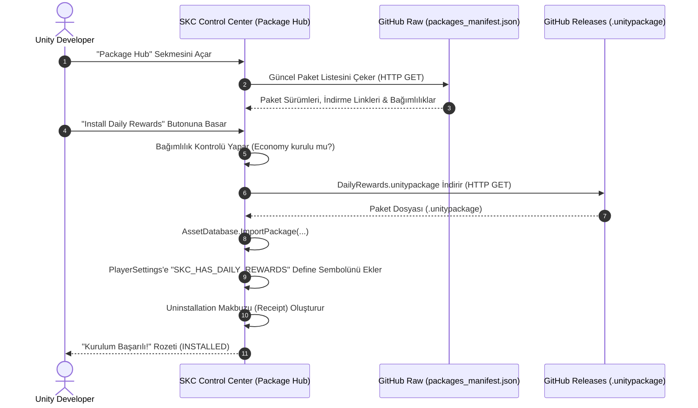
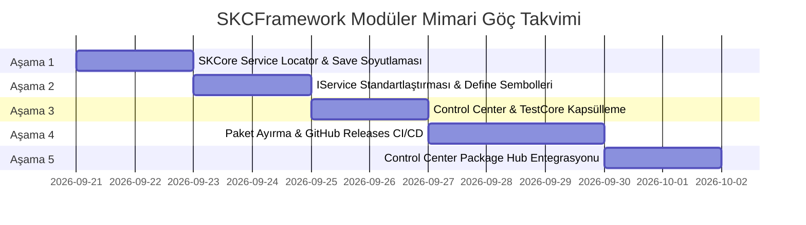

# 🏗️ SKCFramework: Modüler Servis Paketleme & Service Locator Mimari Göç Raporu (Migration Report)

**Tarih:** 20 Eylül 2026  
**Doküman:** `Migrate.md`  
**Hedef:** `SKCore`'u saf bir **Service Locator** haline getirerek temel servisleri (Save, Event, Log) çekirdek (Core) paketinde toplamak; diğer tüm servisleri (`IDailyRewardService`, `ICurrencyService`, `ILevelService` vb.) bağımsız `.unitypackage` modüllerine dönüştürüp **GitHub Releases & SDK Hub** üzerinden isteğe bağlı (on-demand) kurulabilir/kaldırılabilir hale getirmek.

---

## 📌 İçindekiler
1. [Yönetici Özeti & Vizyon](#1-yönetici-özeti--vizyon)
2. [Katmanlı Mimari Şeması](#2-katmanlı-mimari-şeması)
3. [Çekirdek Paket: `SKC.Core` (Foundation / Service Locator)](#3-çekirdek-paket-skccore-foundation--service-locator)
4. [Modüler Paket Envanteri ve Bağımlılık Matrisi](#4-modüler-paket-envanteri-ve-bağımlılık-matrisi)
5. [Potansiyel Blocker'lar ve Teknik Çözüm Stratejileri](#5-potansiyel-blockerlar-ve-teknik-çözüm-stratejileri)
   - [Blocker 1: Monolitik `SKCore.cs` ve Derleme Hataları](#blocker-1-monolitik-skcorecs-ve-derleme-hataları)
   - [Blocker 2: Monolitik `SaveData.cs` Yapısı](#blocker-2-monolitik-savedatacs-yapısı)
   - [Blocker 3: Çapraz ve Zincirleme Bağımlılıklar (Dependency Graph)](#blocker-3-çapraz-ve-zincirleme-bağımlılıklar-dependency-graph)
   - [Blocker 4: `SKCControlCenter` ve `TestCore` Monolitikliği](#blocker-4-skccontrolcenter-ve-testcore-monolitikliği)
   - [Blocker 5: `SKC.Framework.asmdef` Yönetimi ve Dinamik ASMDEF Üretimi](#blocker-5-skcframeworkasmdef-yönetimi-ve-dinamik-asmdef-üretimi-dynamic-assembly-orchestration)
   - [Blocker 6: Asset GUID ve Prefab Bağımlılıkları](#blocker-6-asset-guid-ve-prefab-bağımlılıkları)
6. [GitHub Releases & Manifest Dağıtım Mimarisi](#6-github-releases--manifest-dağıtım-mimarisi)
7. [Adım Adım Göç (Migration) Yol Haritası](#7-adım-adım-göç-migration-yol-haritası)
8. [Sonuç ve Değerlendirme](#8-sonuç-ve-değerlendirme)

---

## 1. Yönetici Özeti & Vizyon

### 🎯 Mevcut Durum (Monolitik Yapı)
Şu anda `SKCFramework`, tüm servislerin (20 adet servis, test paneli, editör araçları ve prefablar) tek bir klasörde (`Assets/Plugins/SKCFramework/`) ve tek bir Assembly Definition (`SKC.Framework.asmdef`) altında yaşadığı **monolitik** bir mimaridir.
- Yeni bir prototip veya mini oyun yaparken bile `DailyRewards`, `IAP`, `Privacy`, `LevelManager`, `CurrencyFly` gibi tüm kodlar projeye dahil olmak zorundadır.
- İhtiyaç duyulmayan bir servis silinmek istendiğinde `SKCore.cs`, `SaveData.cs`, `SKCControlCenter.cs` ve `TestCore.cs` zincirleme derleme hataları verir.

### 🚀 Hedeflenen Durum (Modüler Micro-Package Mimarisi)
1. **SKC.Core (Temel Paket):** Her projenin olmazsa olmazı olan Service Locator (`SKCore`), `SaveService`, `EventService`, `SKCLog`, `Boot` ve `SDK/Package Hub` aracını barındıran hafif (~500 KB) bir başlangıç çekirdeği.
2. **Bağımsız Modüller:** Geriye kalan tüm servisler (`DailyRewards`, `Economy`, `Levels`, `Audio`, `Haptics`, `Pool`, `Transitions`, `UI`, `Ads`, `Analytics`, `IAP`, `Privacy`, `Review`, `Notifications`, `Telemetry`) `IService` arayüzünü uygulayan bağımsız modüller olarak GitHub Releases üzerinde barındırılır.
3. **Tek Tıkla Kurulum / Kaldırma:** Tıpkı şu an MAX veya GameAnalytics kurduğumuz gibi, Control Center içindeki **Package Hub** üzerinden istenen servis tek tıkla indirilir, kurulur, Scripting Define Symbol'ü aktif edilir ve projeye dahil olur. Kaldırıldığında geride 0 çöp ve 0 derleme hatası bırakır.

---

## 2. Katmanlı Mimari Şeması

```mermaid
graph TD
    subgraph Katman 0: Çekirdek Paket (SKC.Core - Zorunlu)
        CORE[SKCore Service Locator]
        SAVE[SaveService & ISaveService]
        EVENT[EventService & IEventService]
        LOG[SKCLog Engine]
        HUB[SDK & Package Hub Engine]
        SETTINGS[SKCoreServiceSettings]
    end

    subgraph Katman 1: Motor Destek Modülleri (Opsiyonel)
        POOL[SKC.ObjectPool]
        SOUND[SKC.Audio]
        TRANS[SKC.Transitions]
        HAPTIC[SKC.Haptics]
        INPUT[SKC.Inputs]
    end

    subgraph Katman 2: Oyun Mekaniği Modülleri (Opsiyonel)
        ECONOMY[SKC.Economy / Currency]
        LEVEL[SKC.LevelManager]
        UI[SKC.UIPopup]
    end

    subgraph Katman 3: Meta & Gelir Modülleri (Opsiyonel)
        DAILY[SKC.DailyRewards]
        ADS[SKC.AdsMediation]
        ANALYTICS[SKC.Analytics]
        IAP[SKC.IAP]
        PRIVACY[SKC.Privacy]
        REVIEW[SKC.InAppReview]
        NOTIF[SKC.Notifications]
        TELEMETRY[SKC.Telemetry]
    end

    POOL -.->|RegisterService| CORE
    SOUND -.->|RegisterService| CORE
    TRANS -.->|RegisterService| CORE
    HAPTIC -.->|RegisterService| CORE
    INPUT -.->|RegisterService| CORE

    ECONOMY --> CORE
    LEVEL --> CORE
    UI --> CORE

    DAILY --> CORE
    DAILY --> ECONOMY
    DAILY -.-> ADS
    IAP --> CORE
    IAP -.-> ADS
    TELEMETRY --> CORE
    TELEMETRY -.-> LEVEL
    TELEMETRY -.-> ANALYTICS
```

---

## 3. Çekirdek Paket: `SKC.Core` (Foundation / Service Locator)

Çekirdek paket, projenin **motoru ve iskeletidir**. Diğer hiçbir modüle bağımlı değildir. Bir Unity projesine ilk import edilen paket bu olacaktır.

### 📦 Çekirdek Paketin İçereceği Dosyalar
| Dosya / Klasör | Sorumluluk | Neden Çekirdekte Olmalı? |
| :--- | :--- | :--- |
| `Boot/SKCore.cs` | Generic Service Locator (`Register`, `Get`, `TryGet`, `Has`) | Tüm servislerin iletişim merkezidir. |
| `Boot/IService.cs` | Servis yaşam döngüsü sözleşmesi (`Initialize`, `IsInitialized`) | Tüm modüllerin ortak paydasıdır. |
| `Boot/BootGame.cs` & Lifecycle | Unity sahne yaşam döngüsü (`AndroidLifeCycle`, `IOSLifeCycle`) | Başlangıç sahnesinin ayakta kalmasını sağlar. |
| `SaveSystem/` | `SaveService.cs`, `ISaveService.cs`, `SaveData.cs` | Neredeyse her oyunun veri kaydetmeye ihtiyacı vardır. |
| `Events/` | `EventService.cs`, `IEventService.cs`, Temel Olaylar | Modüllerin birbirini tanımadan haberleşmesini sağlar. |
| `Logging/` | `SKCLog.cs`, `LogSettings.cs`, `LogTag.cs` | 0-overhead loglama ve Production profili yönetimi. |
| `SOs/SKCoreServiceSettings.cs`| Servislerin hangilerinin otomatik açılacağını belirleyen SO | Merkezi konfigürasyon. |
| `Editor/SDKHub/` | `SDKPackageInstaller.cs`, `SDKHubClient.cs`, Receipt sistemi | Yeni modülleri GitHub'dan indirecek motorun kendisidir. |

---

## 4. Modüler Paket Envanteri ve Bağımlılık Matrisi

Her bir bağımsız modül, `IService` sözleşmesini uygulayacak ve kendine özel bir **Scripting Define Symbol** taşıyacaktır:

| Modül Adı | Paket ID | Scripting Define Symbol | Bağımlılıklar (Dependencies) | Açıklama |
| :--- | :--- | :--- | :--- | :--- |
| **Economy & Currency** | `skc_economy` | `SKC_HAS_ECONOMY` | `SKC.Core` | Soft/Hard currency yönetimi, UI Text binder'lar, 2D/3D coin/gem uçuş controller'ı. |
| **Daily Rewards** | `skc_daily_rewards` | `SKC_HAS_DAILY_REWARDS` | `SKC.Core`, `skc_economy` | 7 günlük döngü, streak takibi, 2x ödül, developer zaman simülatörü. |
| **Level Manager** | `skc_levels` | `SKC_HAS_LEVELS` | `SKC.Core` | Seviye yükleme stratejileri, progress bar, fail/win durumları. |
| **Audio & Sound** | `skc_audio` | `SKC_HAS_AUDIO` | `SKC.Core` | SFX & BGM yönetimi, ses havuzu, mute/volume kontrolleri. |
| **Haptics** | `skc_haptics` | `SKC_HAS_HAPTICS` | `SKC.Core` | iOS Taptic & Android Vibrator soyutlaması. |
| **Object Pooling** | `skc_pooling` | `SKC_HAS_POOLING` | `SKC.Core` | Çoklu havuz, prefab önbellekleme, `IPoolableObject`. |
| **Transitions & Scene** | `skc_transitions` | `SKC_HAS_TRANSITIONS` | `SKC.Core` | DOTween ekran karartma/açma ve asenkron sahne geçişleri. |
| **UI & Popups** | `skc_ui` | `SKC_HAS_UI` | `SKC.Core` | Kuyruklu popup yöneticisi, Toast bildirimleri, HUD köprüleri. |
| **Input Service** | `skc_inputs` | `SKC_HAS_INPUTS` | `SKC.Core` | Dokunmatik ve fare girdileri, drag/swipe/pointer eventleri. |
| **Ads Mediation** | `skc_ads` | `SKC_HAS_ADS` | `SKC.Core` | MAX, ironSource ve Dummy adaptörleri; Rewarded, Interstitial, Banner. |
| **Analytics Engine** | `skc_analytics` | `SKC_HAS_ANALYTICS` | `SKC.Core` | Composite Analytics, GameAnalytics/AppsFlyer adaptör köprüsü. |
| **IAP & No-Ads** | `skc_iap` | `SKC_HAS_IAP` | `SKC.Core` | No-Ads otomasyonu, Interstitial bastırma, satın alım simülatörü. |
| **Privacy & ATT** | `skc_privacy` | `SKC_HAS_PRIVACY` | `SKC.Core` | Apple ATT ve Google UMP/GDPR uyumu, ön-izin modalı. |
| **In-App Review** | `skc_review` | `SKC_HAS_REVIEW` | `SKC.Core` | 30 gün kotalı akıllı mağaza puanlatma tetikleyicisi. |
| **Notifications** | `skc_notifications` | `SKC_HAS_NOTIFICATIONS` | `SKC.Core` | D1 ve D3 tutundurma (retention) yerel bildirimleri. |
| **Telemetry Tracker** | `skc_telemetry` | `SKC_HAS_TELEMETRY` | `SKC.Core` | 0-GC seviye süresi, FPS ve 50ms stutter (lag spike) ölçümü. |

---

## 5. Potansiyel Blocker'lar ve Teknik Çözüm Stratejileri

Bu dönüşümün sorunsuz çalışabilmesi için 6 temel mimari engelin doğru çözülmesi şarttır:

---

### Blocker 1: Monolitik `SKCore.cs` ve Derleme Hataları

#### ❌ Sorun:
Şu an `SKCore.cs` içinde hardcoded olarak `public static readonly DailyRewardService DailyRewardService = new DailyRewardService();` satırı vardır. `DailyRewardService.cs` silindiğinde `SKCore.cs` anında derleme hatası verir.

#### ✅ Çözüm:
`SKCore` saf bir **Service Locator**'a dönüştürülür. Doğrudan sınıf bağımlılıkları kaldırılır, yerine Generic erişim ve Scripting Define korumalı özellikler getirilir:

```csharp
namespace SKC.Core
{
    public static class SKCore
    {
        private static readonly Dictionary<Type, IService> _services = new Dictionary<Type, IService>();

        // 1. Standart Service Locator API
        public static void Register<T>(T service) where T : class, IService
        {
            if (service == null) return;
            _services[typeof(T)] = service;
        }

        public static T Get<T>() where T : class, IService
        {
            return _services.TryGetValue(typeof(T), out var s) ? s as T : null;
        }

        public static bool TryGet<T>(out T service) where T : class, IService
        {
            if (_services.TryGetValue(typeof(T), out var s) && s is T typed)
            {
                service = typed;
                return true;
            }
            service = null;
            return false;
        }

        public static bool Has<T>() where T : class, IService => _services.ContainsKey(typeof(T));

        // 2. Çekirdek Servis Kısayolları (Daima Projede Olanlar)
        public static ISaveService Save => Get<ISaveService>();
        public static IEventService Events => Get<IEventService>();

        // 3. Modüler Servis Kısayolları (Define Sembolü Korumalı)
        #if SKC_HAS_DAILY_REWARDS
        public static IDailyRewardService DailyReward => Get<IDailyRewardService>();
        #endif

        #if SKC_HAS_ECONOMY
        public static ICurrencyService Currency => Get<ICurrencyService>();
        #endif

        #if SKC_HAS_ADS
        public static IAdsService Ads => Get<IAdsService>();
        #endif
    }
}
```
> **Avantaj:** Eğer projede `DailyRewards` yoksa, `#if SKC_HAS_DAILY_REWARDS` bloğu devre dışı kalır. `SKCore` asla derleme hatası vermez!

---

### Blocker 2: Monolitik `SaveData.cs` Yapısı

#### ❌ Sorun:
Şu an `SaveData.cs` içinde `DailyRewardSaveData`, `SoftCurrency`, `Level` gibi her modülün veri tipleri hardcoded olarak tanımlıdır. `DailyRewards` paketini ayırdığınızda `SaveData.cs` içindeki `DailyRewardSaveData` tipi bulunamaz ve derleme çöker.

#### ✅ Çözüm: Modüler / Segment Tabanlı Kayıt Sistemi (Segmented Save Pattern)
`SaveData.cs` modüllerin verilerini tip bağımlılığı olmadan JSON string veya generic dictionary olarak saklar:

```csharp
namespace SKC.Save
{
    [System.Serializable]
    public class SaveData
    {
        public string UserName = string.Empty;
        public int GamePlayVersion = 1;

        // Modüllerin kendi verilerini bağımsızca sakladığı veri havuzu
        [SerializeField]
        private Dictionary<string, string> _modulePayloads = new Dictionary<string, string>();

        public void SetModuleData<T>(string moduleKey, T data)
        {
            _modulePayloads[moduleKey] = JsonUtility.ToJson(data);
        }

        public T GetModuleData<T>(string moduleKey, T defaultValue = default)
        {
            if (_modulePayloads.TryGetValue(moduleKey, out string json) && !string.IsNullOrEmpty(json))
            {
                return JsonUtility.FromJson<T>(json);
            }
            return defaultValue;
        }
    }
}
```
> **Avantaj:** `DailyRewardService`, `CurrencyService` veya `LevelService` kendi save struct/class'larını kendi modüllerinin içinde tutar. Çekirdek `SaveData` hiçbir modülün veri tipini bilmek zorunda kalmaz!

---

### Blocker 3: Çapraz ve Zincirleme Bağımlılıklar (Dependency Graph)

#### ❌ Sorun:
`DailyRewardService` çalışırken `CurrencyService`'e (coin vermek için) ve `AdsService`'e (2x ödül izletmek için) ihtiyaç duyar. Eğer kullanıcı sadece `DailyRewards` paketini indirirse derleme hatası alır.

#### ✅ Çözüm: SDK Hub Bağımlılık Çözücü (Dependency Resolver) & Zayıf Bağlantı (Loose Coupling)
1. **Paket Manifestosu (Manifest):** `packages_manifest.json` dosyasında bağımlılıklar açıkça tanımlanır:
   ```json
   {
       "id": "skc_daily_rewards",
       "name": "SKC Daily Rewards",
       "dependencies": ["skc_economy", "skc_ads"]
   }
   ```
2. **Otomatik Zincirleme Kurulum:** Kullanıcı "Daily Rewards İndir" butonuna bastığında SDK Hub kontrol eder:
   * Eğer `skc_economy` projede yoksa, kullanıcıya bildirim gösterir:  
     `"Daily Rewards paketi 'Economy' paketine ihtiyaç duymaktadır. Otomatik indirilsin mi?"`  
   * `Evet` denildiğinde bağımlılık sırasına göre önce `skc_economy`, ardından `skc_daily_rewards` indirilir.
3. **Kod İçi Zayıf Bağlantı (Soft Dependency):**
   ```csharp
   // Reklam modülü varsa izlet, yoksa direkt ver!
   #if SKC_HAS_ADS
       SKCore.Ads.TriggerRewardedAd("daily_double", onRewarded: () => GrantReward(2));
   #else
       GrantReward(2); // Reklam modülü kurulu değilse akış bozulmaz
   #endif
   ```

---

### Blocker 4: `SKCControlCenter` ve `TestCore` Monolitikliği

#### ❌ Sorun:
`SKCControlCenter.cs` (2400 satır) ve `TestCore.cs` (780 satır) tek bir dosyada tüm sekmeleri ve butonları barındırır. Bir modül silindiğinde bu editör ve test sınıfları derlenemez.

#### ✅ Çözüm:
1. **Define Sembolleri ile Kapsülleme:**
   `TestCore.cs` ve `SKCControlCenter.cs` içindeki ilgili sekme ve butonlar modülün define sembolüyle sarılır:
   ```csharp
   #if SKC_HAS_DAILY_REWARDS
   DrawTabButton(TestTab.DailyRewards, "🎁 Daily Reward", rect);
   #endif
   ```
2. **Modüler Tab Arayüzü (Plugin Architecture - İsteğe Bağlı Gelişmiş Seçenek):**
   Her modül kendi klasörü içine `DailyRewardsControlCenterTab.cs` koyar. `SKCControlCenter` reflection ile `[ControlCenterTab]` taşıyan sınıfları bulup dinamik çizer. Böylece `SKCControlCenter.cs` dosyasına tek bir satır dahi eklemek gerekmez!

---

### Blocker 5: `SKC.Framework.asmdef` Yönetimi ve Dinamik ASMDEF Üretimi (Dynamic Assembly Orchestration)

#### ❌ Mevcut Durum ve Sorunlar:
Şu an `Assets/Plugins/SKCFramework/_Scripts/SKC.Framework.asmdef` dosyası, altındaki tüm servisleri tek bir dev montaj (`SKC.Framework.dll`) halinde derlemektedir. Paketleri bölüp GitHub Releases üzerinden modüler olarak çekmek istediğimizde karşımıza 5 kritik assembly engeli çıkar:

1. **Monolitik `SKC.Framework.asmdef` İkilemi:**
   - Eğer tek bir `SKC.Framework.asmdef` bırakırsak: Projeye yeni bir paket indiğinde, o paket de mecburen bu assembly altına girmek zorundadır. Ancak harici bağımlılıkları (DOTween, TextMeshPro, vs.) yönetmek karmaşıklaşır ve paketleri bağımsız `.unitypackage` olarak dağıtmak imkansızlaşır.
   - Eğer her modüle kendi `.asmdef`'ini verirsek (`SKC.Core.asmdef`, `SKC.DailyRewards.asmdef`): Bu sefer de geliştiricinin kendi oyun kodu (`Game.asmdef` veya `Assembly-CSharp`) her yeni paket indiğinde tek tek referans eklemek zorunda kalır.
2. **GUID Karmaşası vs. Taşınabilirlik (Missing Reference Riski):**
   - Unity varsayılan olarak asmdef referanslarını `GUID:2bafac87e7f4...` olarak kaydeder.
   - Farklı projelerde veya yeni repolarda GUID'ler değiştiğinde Unity `Missing Assembly Reference` hatası verir ve derleme kilitlenir.
3. **Çift Yönlü / Döngüsel Bağımlılık (Circular Dependency) Yasağı:**
   - Unity'de iki asmdef birbirine karşılıklı referans veremez. `SKC.Core` asla `SKC.DailyRewards`'a referans veremez.
4. **Editör Kilitlenmesi (Domain Reload Lock):**
   - Unity'de bir `.asmdef` dosyası diske yazıldığı an Unity editörü durdurup anında scriptleri yeniden derler.
   - Eğer Control Center arka arkaya 3 paketin asmdef'ini döngüde yazarsa, editör 3 kez art arda derleme başlatır ve Unity donabilir.
5. **Kaldırma Sonrası Kalıntı Hatası (Orphan Reference):**
   - Bir modül (örn. `DailyRewards`) SDK Hub'dan kaldırıldığında, ona referans veren diğer asmdef dosyalarından o referans silinmezse Unity sarı uyarı veya derleme blokajı verir.

---

#### ✅ Çözüm: Control Center "Dynamic ASMDEF Orchestrator" (Dinamik Asmdef Motoru)

Control Center içerisine **"Create / Sync ASMDEF"** otomasyonu eklenerek tüm bu engeller sıfır insan hatası ile çözülür:

#### 1. İsim Bazlı (Name-Based) Referans Standardı
GUID bağımlılığından tamamen kurtulmak için üretilen tüm asmdef dosyalarında doğrudan kararlı isimler kullanılır:
```json
{
    "name": "SKC.DailyRewards",
    "rootNamespace": "SKC.DailyRewards",
    "references": [
        "SKC.Core",
        "SKC.Economy"
    ],
    "autoReferenced": true,
    "defineConstraints": [
        "SKC_HAS_DAILY_REWARDS"
    ]
}
```
> **Avantaj:** GUID ne olursa olsun Unity isim üzerinden eşleme yapar; projeler arası taşımalarda referanslar asla kopmaz.

#### 2. Control Center: 2 Farklı ASMDEF Modu Desteği (Kullanıcı Tercihli)
Control Center arayüzünde geliştiriciye iki seçenek sunulur:
- **Mod A: "Mikro-Assembly (Modüler)" [ÖNERİLEN]:**
  - İndirilen her paket kendi bağımsız asmdef'i ile yaşar (`SKC.Core.asmdef`, `SKC.Economy.asmdef`, `SKC.DailyRewards.asmdef`).
  - **Faydası:** Bir serviste kod değiştirdiğinizde tüm framework yeniden derlenmez; sadece o modül 1-2 saniyede derlenir (Maksimum geliştirici verimliliği).
- **Mod B: "Dinamik Monolitik (Rebuild SKC.Framework.asmdef)":**
  - Çok sayıda DLL istemeyen geliştiriciler için Control Center, projede o an kurulu olan tüm SKC modüllerini tarar ve tek bir `SKC.Framework.asmdef` dosyasını otomatik generate eder.

#### 3. Tek Tıkla Oyun Koduna Bağlama (`[ 🔗 Link to Game Assembly ]`)
Kendi oyun kodlarını `Game.asmdef` altında toplayan projeler için Control Center'a bir senkronizasyon butonu eklenir:
- Projedeki `Game.asmdef` dosyasını otomatik tespit eder.
- Kurulu tüm SKC modüllerini (`SKC.Core`, `SKC.Economy`, `SKC.DailyRewards` vb.) `Game.asmdef` referans listesine tek tıkla enjekte eder.
- Kaldırılmış paketleri referans listesinden otomatik temizler.

#### 4. Kilitlenmeyi Önleyen Güvenli Yazım (Batching)
Birden fazla asmdef oluşturulurken Unity'nin defalarca derlemeye girmesini önlemek için `AssetDatabase.StartAssetEditing()` kalkanı kullanılır:
```csharp
AssetDatabase.StartAssetEditing(); // Derlemeyi geçici duraklat
try 
{
    // 1. Kurulu paketlerin asmdef'lerini üret/güncelle
    // 2. references listelerini senkronize et
}
finally 
{
    AssetDatabase.StopAssetEditing(); // Tüm değişiklikleri tek seferde derle
    AssetDatabase.Refresh();
}
```

#### 5. Uninstaller ile Entegre Otomatik Temizlik
SDK Hub üzerinden bir modül silindiğinde (`Clean Uninstall`):
- O modülün `.asmdef` dosyası silinir.
- Varsa diğer bağımlı asmdef'lerin `references` dizisinden o modülün ismi otomatik ayıklanır.
- Böylece geride asla `Missing Assembly Reference` kalmaz.

---

### Blocker 6: Asset GUID ve Prefab Bağımlılıkları

#### ❌ Sorun:
Örneğin `CurrencyFlyController`'ın kullandığı Coin ve Gem prefabları veya `TransitionService`'in Canvas prefabları projeden projeye taşınırken GUID eşleşmesi bozulursa `Missing Prefab` hatası oluşur.

#### ✅ Çözüm: Bağımsız Modül Yapısı (Self-Contained Packages)
Her modül kendi prefab ve asset'lerini kendi klasöründe tutar:
```text
SKC_Economy/
├── _Scripts/
│   ├── CurrencyService.cs
│   └── CurrencyFlyController.cs
├── Prefabs/
│   ├── PF_CoinParticle.prefab
│   └── PF_GemParticle.prefab
├── Resources/
│   └── CurrencyConfig.asset
└── SKC.Economy.asmdef
```
Prefab referansları `Resources.Load` veya paket içi serialized ScriptableObject ile taşınır; böylece `.unitypackage` import edildiğinde GUID'ler asla kopmaz.

---

## 6. GitHub Releases & Manifest Dağıtım Mimarisi

Sistem mevcut SDK Hub'ımızın altyapısı üzerine inşa edilecektir.

### 🌐 GitHub Dağıtım Akışı


### 📄 `packages_manifest.json` Örnek Şeması
```json
{
  "frameworkVersion": "2.0.0",
  "packages": [
    {
      "id": "skc_economy",
      "name": "Economy & Currency Engine",
      "version": "1.0.0",
      "category": "Gameplay",
      "description": "Soft/Hard currency management, UI binders, and 2D/3D coin fly animations.",
      "downloadUrl": "https://github.com/SemihKC94/skc-unity-plugins/releases/download/v1.0.0/SKC.Economy.unitypackage",
      "scriptingDefineSymbol": "SKC_HAS_ECONOMY",
      "detectionPath": "Assets/Plugins/SKCFramework/Economy",
      "dependencies": []
    },
    {
      "id": "skc_daily_rewards",
      "name": "Daily Rewards System",
      "version": "1.0.0",
      "category": "Meta",
      "description": "7-day reward cycle, streak multipliers, 2x ad claim, and time simulation.",
      "downloadUrl": "https://github.com/SemihKC94/skc-unity-plugins/releases/download/v1.0.0/SKC.DailyRewards.unitypackage",
      "scriptingDefineSymbol": "SKC_HAS_DAILY_REWARDS",
      "detectionPath": "Assets/Plugins/SKCFramework/DailyRewards",
      "dependencies": ["skc_economy"]
    }
  ]
}
```

---

## 7. Adım Adım Göç (Migration) Yol Haritası

Projeyi bozmadan ve sıfır riskle bu mimariye geçiş için önerilen 5 aşamalı plan:



### 📍 Aşama 1: `SKCore` & `SaveData` Soyutlaması
- `SKCore.cs` dosyasındaki statik somut `new XService()` değişkenlerini generic Service Locator'a çevirmek.
- `SaveData.cs` sınıfına modüler dictionary/segment desteği eklemek.
- `SKCore`'un mevcut projede kesintisiz derlendiğini doğrulamak.

### 📍 Aşama 2: Define Sembolleri ile Modül Koruması
- Her modülün başına `#if SKC_HAS_[MODULE]` korumalarını eklemek.
- Mevcut projede tüm define sembollerini açık bırakarak geriye dönük uyumluluğu (backward compatibility) korumak.

### 📍 Aşama 3: Control Center ve Test Paneli Uyarlaması
- `SKCControlCenter.cs` ve `TestCore.cs` dosyalarındaki sekmeleri ilgili define sembollerine bağlamak.
- Bir modülün define sembolü silindiğinde projenin 0 hata ile derlendiğini test etmek.

### 📍 Aşama 4: Paketleri Klasör Klasör Ayırma ve Export
- Her modülü kendi klasöründe izole etmek (`Assets/Plugins/SKCFramework/[ModuleName]`).
- Unity Editor Export Scripti hazırlayarak her klasörü tek komutla `.unitypackage` olarak dışa aktarmak.
- Dışa aktarılan paketleri GitHub Releases'a (`v1.0.0`) yüklemek.

### 📍 Aşama 5: Control Center "Package Hub" Sekmesi
- Mevcut SDK Hub'ın yanına veya içine **"SKC Modular Packages"** listesi eklemek.
- GitHub'daki `packages_manifest.json` dosyasını bağlayarak tek tıkla indir/kaldır testlerini tamamlamak.

---

## 8. Sonuç ve Değerlendirme

| Kriter | Monolitik Yapı (Şu anki) | Modüler Paket Yapısı (Hedeflenen) |
| :--- | :--- | :--- |
| **Başlangıç Proje Boyutu** | ~40 - 50 MB (Gereksiz tüm kod ve assetler) | **~1 - 2 MB (Sadece SKC.Core)** |
| **Derleme Süresi (Compile Time)** | Tüm framework tek parçada derlenir | **Sadece kullanılan modüller bağımsız derlenir** |
| **Kod Karmaşası & Esneklik** | İhtiyaç olmayan servisler projede yer kaplar | **Yalnızca kullanılan servisler projede bulunur** |
| **Güncellenebilirlik** | Tüm framework'ü güncellemek gerekir | **Sadece ilgili modül (örn. DailyRewards v1.1) güncellenir** |
| **Hata Riski** | Bir servisi silmek tüm projeyi bozar | **Temiz kaldırma (Clean Uninstall) ile sıfır risk** |

Bu rapor, projenizin mevcut hiçbir koduna dokunulmadan yapılmış tam kapsamlı bir analizdir. İlgili strateji onaylandığında Aşama 1'den başlanarak güvenli ve kontrollü bir şekilde hayata geçirilebilir.
