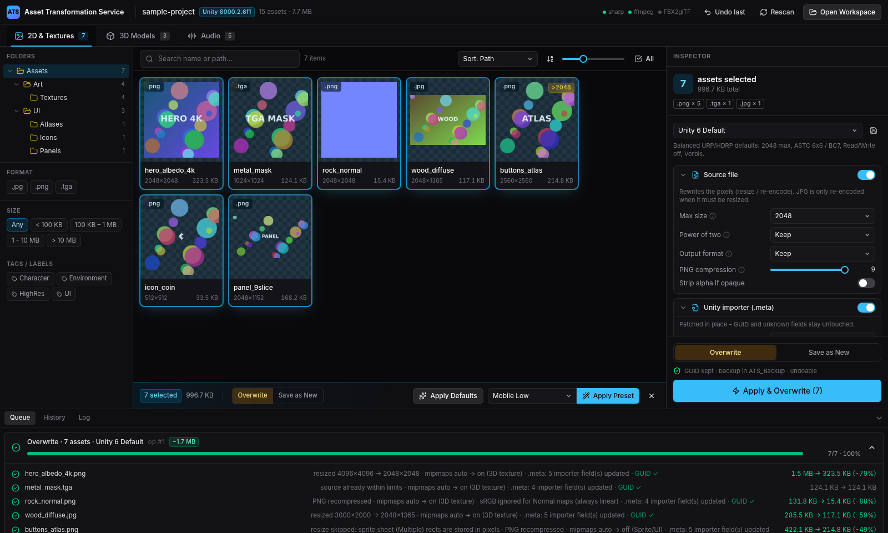
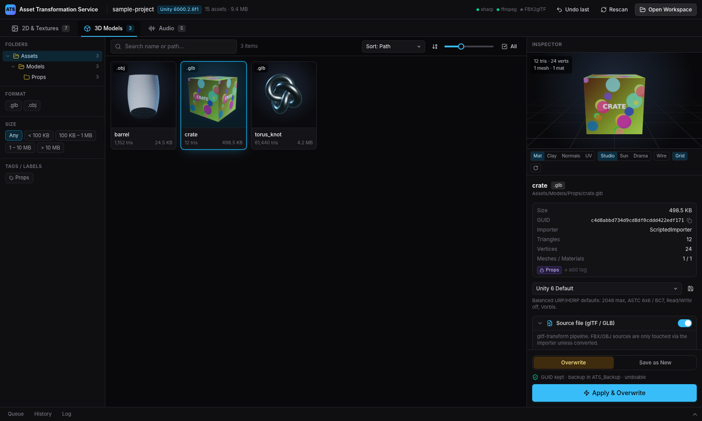
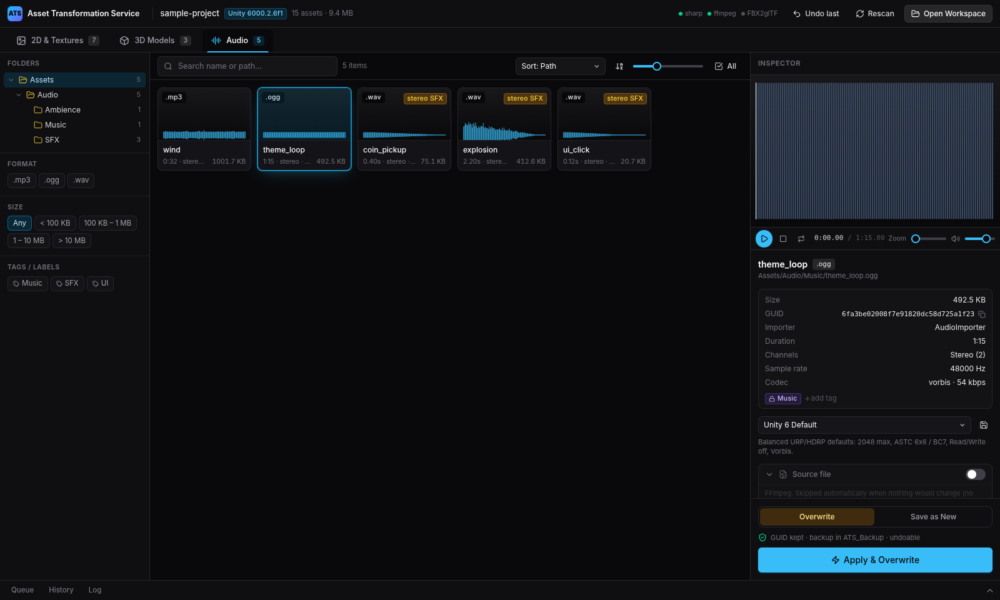

# Asset Transformation Service (ATS)

Desktop tool (Electron + React + TypeScript) for batch-optimizing **Unity 6** project assets (textures, models, audio) **without breaking GUID references**.



| 3D models | Audio |
|---|---|
|  |  |

## Quick start

```bash
npm install                    # ELECTRON_SKIP_BINARY_DOWNLOAD=1 if you only want the web preview
npm run sample                 # generates ./sample-project (a small Unity 6 project with .meta files)

# Desktop app (the real target)
npm run rebuild:electron       # compiles better-sqlite3 for Electron's ABI
npm run dev                    # File › Open Workspace… (Ctrl+O) → pick the folder that contains Assets/

# Browser preview (same UI + same core, over HTTP)
npm run rebuild:node           # better-sqlite3 back to the Node ABI
ATS_WORKSPACE=./sample-project npm run web     # → http://localhost:5178

npm test                       # 22 tests: meta patching, GUID safety, undo, TGA codec, end-to-end apply
npm run package                # electron-builder (dmg / nsis / AppImage)
```

Optional: install [FBX2glTF](https://github.com/facebookincubator/FBX2glTF) (put it on your PATH, set `ATS_FBX2GLTF`, or run `npm i fbx2gltf`) to enable FBX → GLB conversion.

## Architecture

```
src/
  shared/      types, Unity 6 defaults + built-in presets, RPC whitelist   (no Node/DOM imports)
  core/        pure Node – no Electron imports
    service.ts     AtsService facade (both transports call this)
    scanner.ts     Assets/ walk → SQLite index      watcher.ts  chokidar live sync
    meta.ts        .meta line-level editor (GUID-locked)   importers.ts  settings → Unity enum values
    transform.ts   source step → importer step → backup → atomic commit → GUID verify → rollback
    jobs.ts        queue (JobBackend interface)     db.ts       better-sqlite3 (project + global DB)
    processors/    texture (sharp) · tga codec · audio (fluent-ffmpeg) · model (gltf-transform)
  main/        Electron main: menu, IPC, privileged ats:// protocol (files + thumbnails)
  preload/     sandboxed CJS bridge (window.atsBridge)
  server/      web preview: HTTP RPC + SSE events + file routes
  renderer/    React 19 + Tailwind 4 + shadcn-style UI, Zustand, r3f/drei, wavesurfer.js
```

On-disk layout inside the Unity project:

| Path | Purpose |
|---|---|
| `.ats/ats.db` | asset index, tags, operations, history (hidden folder, so Unity ignores it) |
| `.ats/thumbs`, `.ats/tmp` | thumbnail cache; temp outputs (same filesystem, so renames are atomic) |
| `ATS_Backup/<op>_<time>/` | pre-change copies of every file an operation replaces. **Deliberately outside `Assets/`**; inside it, Unity would import the backups as duplicate assets with clashing GUIDs |

## How the .meta safety works

1. **Two layers per preset.** *Source* rewrites the file bytes (resize, re-encode, downmix, glTF optimize). *Importer* sets the Unity import settings (compression, mipmaps, Read/Write, load type…), and those live **inside the `.meta`**.
2. So the rule is really "**never change the GUID**", not "never touch the `.meta`". `MetaEditor` patches individual scalar lines in place. It keeps key order, unknown fields and CRLF/LF, never invents keys, and throws if anything targets `guid:`.
3. Overwrite flow: back up the asset and its `.meta` → `rename()` temp files into place → re-read the `.meta` from disk and compare GUIDs → on mismatch, restore from the backup and mark the item failed.
4. **Save as New** copies the importer settings into a new `.meta` with a **fresh GUID**. Re-running it refreshes the existing output and keeps *that* file's GUID, so references to `_mobile` copies survive too.
5. Unity-specific traps handled:
   - **Sprites:** a source downscale scales `spritePixelsToUnits` and 9-slice `spriteBorder`, so on-screen size doesn't change.
   - **Multiple-mode sprite sheets** are never resized, because their rects are stored in pixels.
   - **Format changes** (png→jpg, wav→ogg) only happen in Save as New; in Overwrite they would orphan `foo.png.meta`.
   - **Lossy sources** (jpg, mp3, ogg) are never re-encoded unless something actually changes.

## Where this differs from the spec

| Spec | Implementation | Why |
|---|---|---|
| BullMQ + Redis | In-process queue behind `JobBackend` | Redis on every artist's machine is heavy. The interface allows a BullMQ backend later |
| "Never modify .meta" | Modify importer fields, never the GUID | Unity 6 import settings (ASTC/BC7, mipmaps, Load Type…) only exist in the `.meta` |
| Audio "Opus (Web)" | Vorbis / ADPCM / PCM | The AudioImporter enum ATS targets has no Opus entry |
| GLB preferred over FBX | GLB optimize + optional FBX→GLB (Save as New) | Unity needs **glTFast** for .glb; ModelImporter settings don't apply to glTF |
| WebP output | Not offered | Unity's TextureImporter can't read WebP |
| `ATS_Backup` (location unspecified) | Project root | Must not be inside `Assets/` |

## Status and next steps

- **Done:** Phase 1–2 in full, plus most of 3–4 (multi-select, queue and progress, 4 built-in and user presets, backup/undo, history log).
- **Verified in this environment:** core tests; web preview end to end in headless Chromium; `electron-vite build` output. The Electron window itself was not launched (no display available).
- **Next steps:**
  - Run glTF processing in a `utilityProcess`/worker. It currently runs async in the main process, so the UI stays responsive but IPC can stall on huge models.
  - Scale sprite-sheet rects instead of skipping resize.
  - Write asset labels back to the `.meta`.
  - BullMQ adapter.
  - FBX2glTF conversion test with a real FBX.
